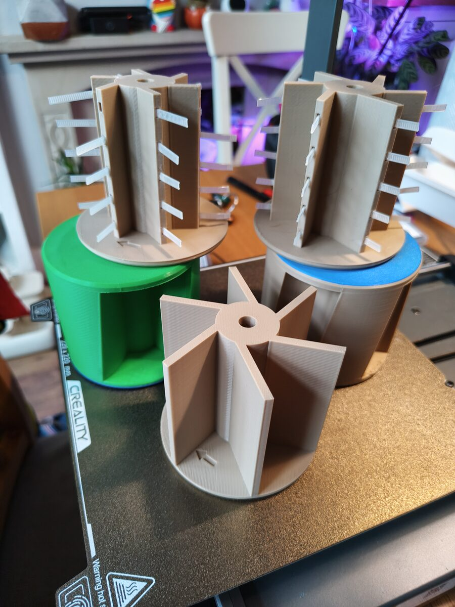
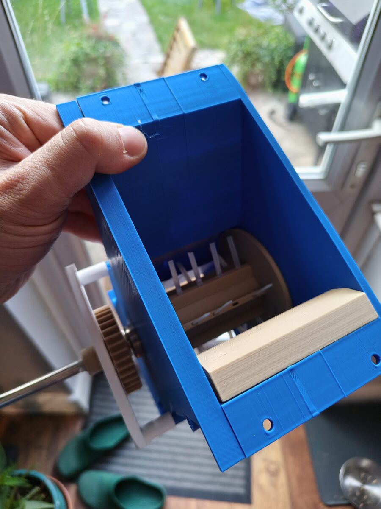
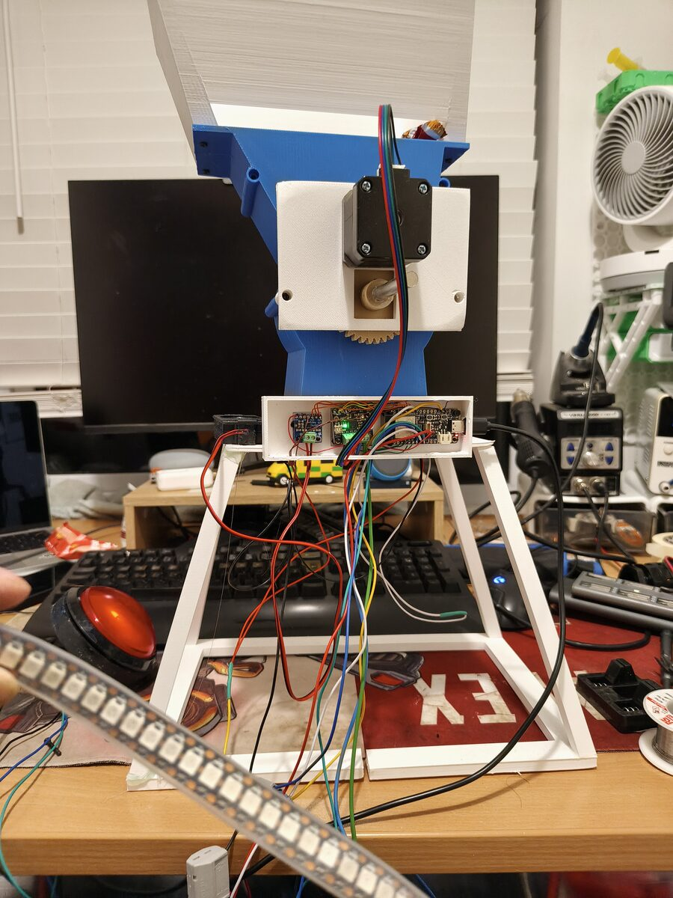
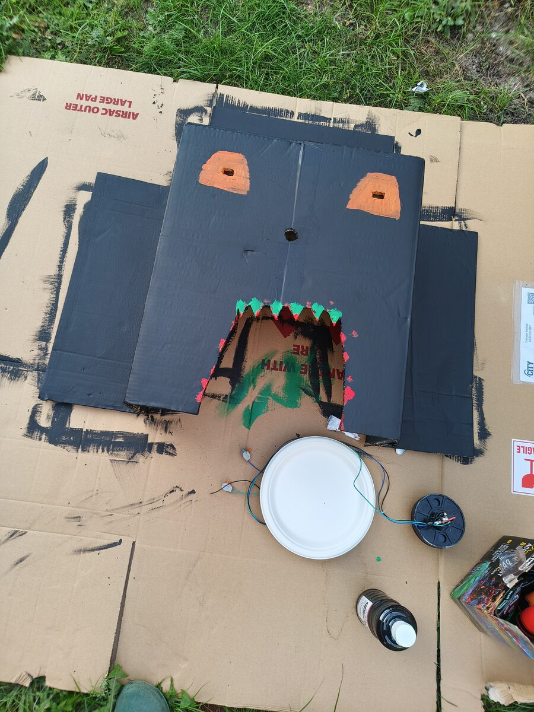
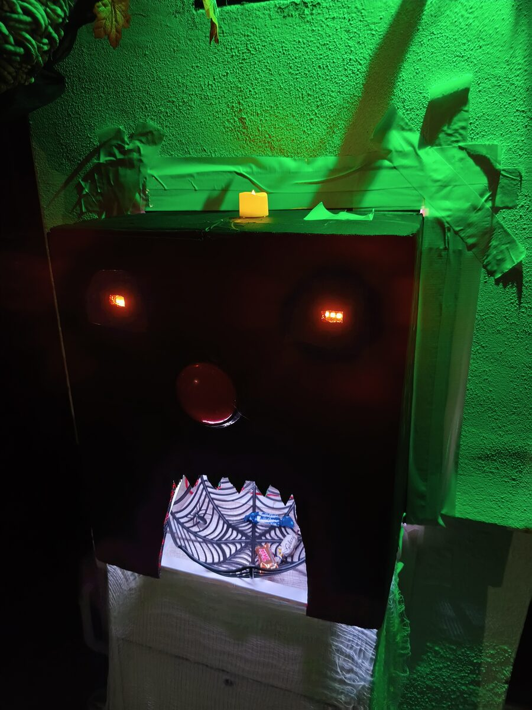
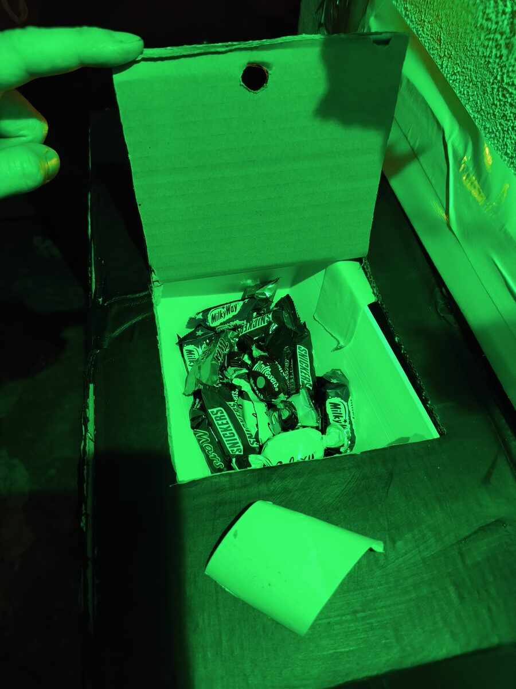

# Celebration Dispenser

[](https://github.com/max246/celebration-dispenser/actions/workflows/firmware.yml)
[](LICENSE)

A button-triggered desktop celebration machine. Press the button and it dispenses
a treat (confetti, candy, sprinkles — your choice) via a stepper-driven mechanism
while a WS2812 LED strip runs a light show and a sound plays over a small
amplifier.

This repo has two halves:

| Folder      | What's inside                                                        |
|-------------|----------------------------------------------------------------------|
| [`hardware/`](hardware/) | 3D-printable STL parts (finger-wheel dispenser) + bill of materials + assembly guide |
| [`firmware/`](firmware/) | ESP32-S2 firmware (PlatformIO / Arduino) that runs the dispenser |

## Results

It ended up as a Halloween installation — watch it in action:

[](https://www.youtube.com/watch?v=IRejrBzZh8A)

### Showcase

From printed prototypes to a candy-eating monster on Halloween night:

| | | |
|:---:|:---:|:---:|
|  |  |  |
| Finger-wheel prototypes | Wheel + gear in the housing | Full bench build: hopper, NEMA 17, ESP32-S2, button, LED strip |
|  |  |  |
| Painting the monster face | Installed: press the nose, get candy | Loaded with treats |

## How it works

```
        [ push button ]
              │  press
              ▼
    ┌──────────────┐   UART+step/dir   ┌──────────┐
    │  ESP32-S2    │ ────────────────▶ │ TMC2209  │─▶ NEMA 17 ─▶ finger wheel
    │  Feather     │ ◀──── DIAG stall ─┘ (auto-unjam on jam)
    │  (WiFi)      │ ────────────────▶ WS2812 strip ─▶ light show
    │              │ ──I2S──▶ MAX98357A ─▶ speaker ─▶ audio (from on-board flash)
    └──────────────┘
```

On a button press the ESP32-S2 runs a single **celebration sequence**: the
TMC2209 turns the finger wheel to dispense a portion (backing off and retrying if
StallGuard detects a jam), a rainbow sweeps the LED strip, and a sound plays from
on-board flash through the MAX98357A — all at the same time — then it returns to
idle.

## Quick start

1. **Print & wire the hardware** — see [`hardware/README.md`](hardware/README.md)
   and the wiring diagram in [`docs/WIRING.md`](docs/WIRING.md).
2. **Flash the firmware** — see [`firmware/README.md`](firmware/README.md). Bench-test
   the motor first with `pio run -e motortest -t upload`.
3. Power it up, press the button, celebrate.

## Tuning

Almost everything you'll want to change (dispense amount, speed, stall
sensitivity, LED count, volume, GPIO pins) lives in
[`firmware/include/config.h`](firmware/include/config.h); the celebration and
idle sounds are 16-bit WAV files in `firmware/data/` (uploaded with
`pio run -t uploadfs`). The printable parts and assembly guide live in
[`hardware/`](hardware/).

## License

[MIT](LICENSE) © Christian Bianchini. The sounds used in the final build are
included — source MP3s in `music/`, ready-to-flash WAVs in `firmware/data/`
(`pio run -t uploadfs`). They are not covered by the MIT license; swap in your
own if you redistribute.
